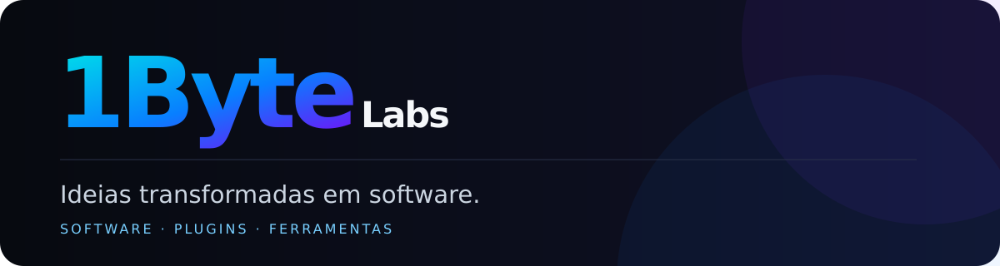
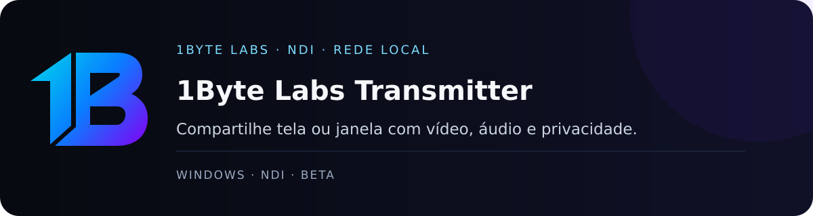
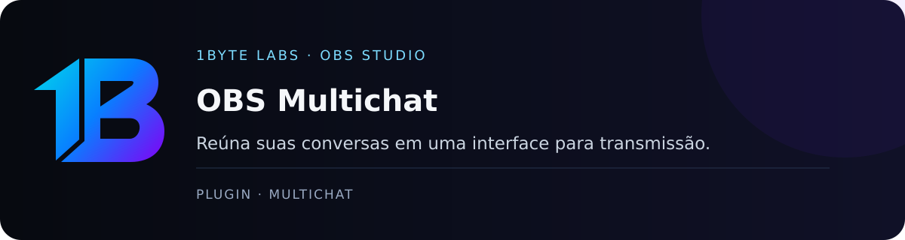
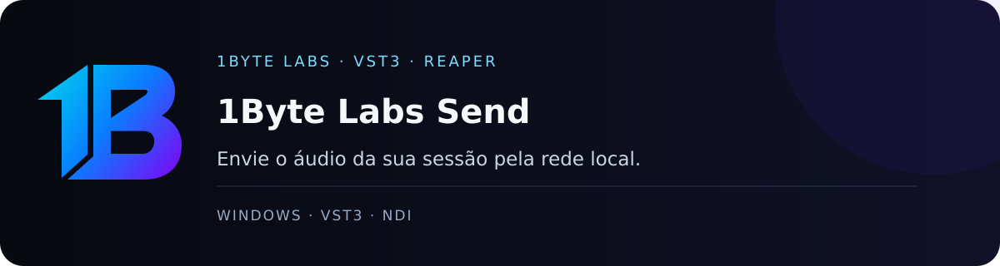
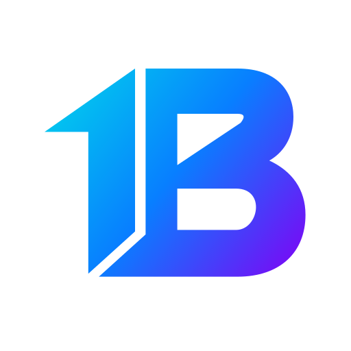

 

### Software para transformar fluxos complexos em ferramentas simples.

A 1Byte Labs cria produtos independentes para **produção, mídia, apresentações e workflows técnicos** — do plugin integrado ao aplicativo completo.

---

## Produtos

<table>
<tr>
<td width="50%" valign="top">

  
<strong>Fundos por Culto</strong> 
Automação de fundos da Bíblia por perfil, setlist e programação.  
<code>SPresenter</code> <code>Windows</code> <code>macOS</code>  
<a href="https://github.com/1bytelabs/fundos-por-culto-spresenter">Ver projeto →</a>
</td>
<td width="50%" valign="top">

  
<strong>Importador de Vídeos</strong> 
Pesquisa, processamento e importação de vídeos direto para o SPresenter.  
<code>SPresenter</code> <code>Windows</code> <code>macOS</code>  
<a href="https://github.com/1bytelabs/importador-videos-spresenter">Ver projeto →</a>
</td>
</tr>
<tr>
<td width="50%" valign="top">

  
<strong>Fundos Para Letras</strong> 
Fundos independentes e personalizáveis para cada linha de letra.  
<code>SPresenter</code> <code>Open source</code>  
<a href="https://github.com/1bytelabs/fundos-para-letras-spresenter">Ver projeto →</a>
</td>
<td width="50%" valign="top">

  
<strong>1Byte Labs Transmitter</strong> 
Transmissão NDI portátil de tela ou janela com vídeo, áudio e privacidade.  
<code>Windows</code> <code>NDI</code> <code>Beta</code>  
<a href="https://github.com/1bytelabs/1bytelabs-transmitter">Ver projeto →</a>
</td>
</tr>
<tr><td width="50%" valign="top">  <strong>OBS Multichat</strong> Conversas integradas à sua transmissão.  <a href="https://github.com/1bytelabs/obs-multichat">Ver projeto →</a></td><td width="50%" valign="top">  <strong>1Byte Labs Send</strong> Plugin VST3 para envio de áudio via NDI. Protótipo em desenvolvimento.  <a href="https://github.com/1bytelabs/1bytelabs-transmitter/tree/feature/zosma-send-vst3">Ver protótipo →</a></td></tr>
</table>

---

## Produto em destaque

### Seu playback. Seu setlist. Tudo sob controle.

O **Multitrack Tools** transforma o REAPER em uma central para playback ao vivo, reunindo setlists, regiões, loops, pads, click, alteração de tom, cifras, projeção, automações, MIDI e controle web.

**Windows · macOS · Linux** &nbsp; · &nbsp; **Licença vitalícia** &nbsp; · &nbsp; **Atualizações incluídas**

[**Conhecer o Multitrack Tools →**](https://1bytelabs.com.br)

---

## Um ecossistema, diferentes workflows

`SPresenter` &nbsp; `REAPER` &nbsp; `NDI` &nbsp; `Windows` &nbsp; `macOS` &nbsp; `Linux`

Plugins, aplicações e ferramentas pensados para integrar-se ao que você já usa — sem adicionar complexidade desnecessária ao fluxo.

### Conteúdo & comunidade

[**YouTube**](https://www.youtube.com/@zosmalabs) &nbsp; · &nbsp; [**Tutoriais**](https://www.youtube.com/@zosmalabs) &nbsp; · &nbsp; [**Projetos open source**](https://github.com/1bytelabs?tab=repositories) &nbsp; · &nbsp; [**GitHub**](https://github.com/1bytelabs)

 

### Ideias transformadas em software.

**[1bytelabs.com.br](https://1bytelabs.com.br)** · [contato@1bytelabs.com.br](mailto:contato@1bytelabs.com.br)

